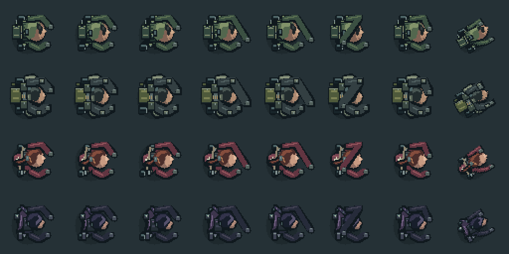
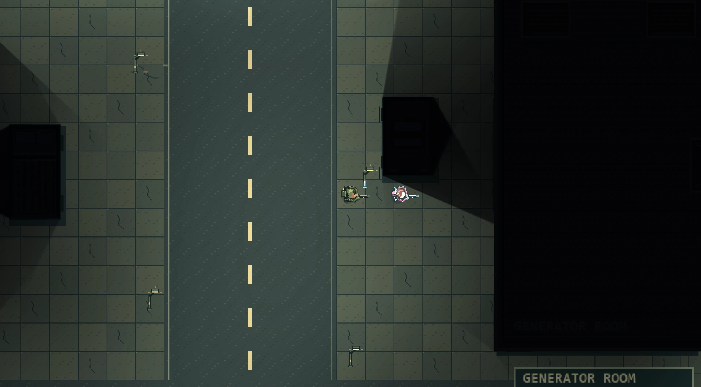
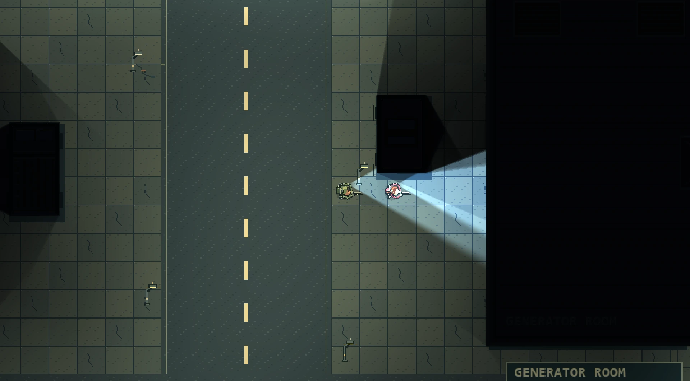

Since the first demo went up, we have been building the systems the rest of the campaign will stand on. This post covers what changed.

One important note first: **none of this is in the public demo yet.** The demo on itch.io is still version 0.1.0. Everything below is in our current development build and is still being playtested, so details may change.

## Four soldiers, drawn from scratch

The squad now has four members: **Assault**, **Support**, **Elena Voss**, a medic, and **Raven Cross**, a marksman. Each one was drawn by hand in Pixelorama with its own silhouette: different hair, gear, bags and shoulder armour. They are not recoloured copies of the same sprite.

Every character has eight animations: idle, walk, run, aim, shoot, reload, hurt and death. Support carries the heaviest kit, with more health (140 instead of 100) and a slightly slower run. All four use the same weapon grip system as the original soldier, so all six weapons sit correctly in their hands.

## Switching between characters, with AI teammates

You can take control of any available squad member with **F1–F4**, or cycle through them with **Tab**. Each character keeps their own health, position, weapon and ammunition.

The members you are not controlling are run by AI. They follow you in a formation that adapts to the direction you are moving and tightens up in narrow passages. They share the same navigation as the zombies, choose targets by threat, and fight with whatever weapon they are carrying. Teammates can take damage and be taken out of the fight, so you cannot ignore them.

## Chapter 1 is now a two-person mission

In the development build, Chapter 1 is no longer played alone: **Elena Voss** joins Assault as an AI teammate. She also has her own flashlight now, and switches it on by herself when the area around her is dark.

The plan is to grow the squad as the story moves forward: Assault and Elena first, then Support, then Raven Cross. This line-up is part of the long-term story plan for 250 chapters, and it may still change.

## Military Credits and the supply store

The squad now shares a balance of **Military Credits (CR)**. Finishing Chapter 1 pays a one-time reward of **500 CR**. The reward is tied to your save, so replaying the chapter or starting a New Game cannot pay it twice.

After the chapter, you visit the **Military Supply Terminal**. It sells 14 items, including weapons, ammunition and medkits in three sizes, and you choose which squad member receives each purchase. Paying, delivering the item and saving all happen as one step, so a crash in the middle of a purchase cannot cost you credits or items.

This also changes how weapons work. They no longer lie around the map for free. You buy them, and the squad’s weapons, ammunition, health and credits are saved with your campaign. The economy can also reward kills and objectives, but those rewards are switched off in Chapter 1 for now.

## Telling the story through dialogue

Chapter 1 now opens and closes with short conversations between Assault and Elena: nine lines at the start and seven at the end. They appear in a panel at the bottom of the screen, on top of the game world, with a portrait, the speaker’s name, a progress counter and Next and Skip buttons. Skip asks for confirmation. If you prefer the text to appear at once, the typewriter effect can be turned off in Settings.

We also drew a set of comic-style story panels in Pixelorama. They are not yet at the quality we want, so they are not in the game.

The main menu now has **Continue** and **New Game**. New Game asks for confirmation and resets only your Chapter 1 progress. Put together, the chapter now runs from start to finish:

> language selection → main menu → opening dialogue → the mission → completion reward → supply store → closing dialogue → “Chapter 2: Coming Soon”

## Twenty languages

On first launch the game now asks you to choose a language, and you can change it later in Settings. The interface and the Chapter 1 dialogue are available in twenty languages: English, Turkish, Japanese, Simplified and Traditional Chinese, Korean, German, French, Spanish for Latin America and for Spain, Brazilian Portuguese, Italian, Russian, Polish, Arabic, Dutch, Indonesian, Thai, Vietnamese and Ukrainian.

To be honest about how they were made: apart from English, the translations were produced with machine translation tools that run offline. They have not been reviewed by native speakers yet. If you spot something that reads wrong in your language, please tell us.

## The case of the disappearing flashlight

During testing, the flashlights sometimes vanished completely, and it happened most often when Elena was right next to Assault. The cause turned out to be a rendering limit rather than the flashlight itself.

The renderer we use can light any single sprite with at most **15 lights**. The camp’s ground was made of 16 large 1024-pixel pieces. Once the generator was running, up to 22 lights could reach a single piece. With Elena’s muzzle flashes, bullet impacts and her flashlight added, that rose to 26. When a piece is reached by more lights than the limit, the renderer skips the extra ones across that whole piece, and the flashlights were among the lights it dropped.

The fix keeps the art exactly the same: when the level loads, the ground is now split into 128-pixel pieces, so each piece is reached by far fewer lights. Below is the same spot with the power on, before and after the fix.

## What’s next

Right now we are playtesting all of this inside Chapter 1: the duo, the AI teammate, the store, the dialogue and the languages. After that, work moves on to Chapter 2.

The public demo on itch.io is still version 0.1.0. We will post here when a new build is available. Until then you can play the current demo, and feedback is always welcome in the itch.io comments or at zerquna.studios@gmail.com.

Play the current demo on itch.io: [zerqunastudios.itch.io/velkrion-the-first-breach](https://zerqunastudios.itch.io/velkrion-the-first-breach)
