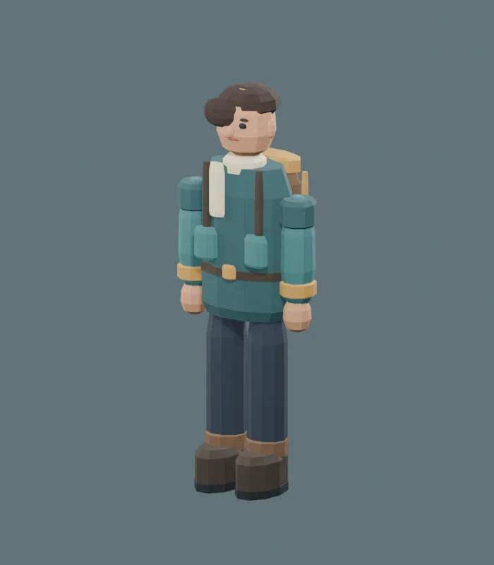

Echoes of the Earth hâlâ aktif olarak geliştiriliyor ve ücretsiz demosu artık itch.io’da. Bu yazı, oyunda doğrudan bakmadığınız ama sürekli üzerinde yürüdüğünüz kısımla ilgili: voxel dünya.

## Neden voxel?

Her yerini değiştirebileceğiniz bir dünya istedik: bir tepeyi kazmak, bir ağacı blok blok kesmek, tarlanın olduğu yere bir ev kurmak. Bir ızgarada saklanan bloklardan oluşan voxel dünya bunu mümkün kılıyor. Keşfe de çok uygun, çünkü dünya siz ilerledikçe üretilebiliyor.

## Bloklar, chunk’lar ve mesh’ler

Dünya, bir kenarı 16 blok olan chunk’lara bölünüyor. Tek doğru kaynak blok verisi: gördüğünüz, çarptığınız ve nişan aldığınız her şey aynı veriden geliyor; zamanla birbirinden kopabilecek ayrı kopyalar yok.

Her chunk, görünen mesh’ini yalnızca havaya bakan blok yüzlerinden oluşturuyor. Toprağın içine gömülü yüzler atlanıyor. Çarpışma da aynı mantıkla çalışıyor: her blok için ayrı bir collider yerine her chunk, katı yüzeylerinden üretilen ve görsel mesh’ten ayrı tutulan tek bir çarpışma mesh’i alıyor. Gösterecek bir şeyi olmayan chunk’a hiç collider eklenmiyor.

Bir blok kırdığınızda ya da yerleştirdiğinizde bütün dünya değil, yalnızca o chunk ve değişen yüzü paylaşan komşuları yeniden oluşturuluyor. Bu işler kare başına bir bütçesi olan bir kuyruktan geçiyor (varsayılan olarak her karede dört chunk). Böylece art arda gelen değişiklikler oyunu dondurmuyor.

Nişan alma, ışını doğrudan voxel ızgarasının içinde yürütüyor. Bu sayede hedeflediğiniz blok, verideki blokla birebir aynı.

## Dünyayı üretmek

İlk prototip 64 × 64 × 64 boyutunda küçük bir test dünyasıydı. Bugün dünya bir seed’den ovalar, ormanlar, çöller ve kayalık yaylalar gibi farklı arazilere dönüşüyor ve akışlı olarak yükleniyor: bütün dünya bellekte tutulmuyor, chunk’lar çevrenizde yüklenip kaldırılıyor.

Akışlı yükleme bir soruyu beraberinde getirdi: bellekten kaldırılmış bir chunk’ta değiştirdiğiniz bloklara ne oluyor? Çözüm, iki katman tutmak. Üretilen temel dünya her zaman seed’den yeniden oluşturulabiliyor; sizin değişiklikleriniz ise ayrı, seyrek bir fark listesi olarak saklanıyor. Chunk yeniden yüklendiğinde önce yeniden üretiliyor, ardından değişiklikleriniz üzerine uygulanıyor.

Her dünya kendi kayıt yuvasında duruyor. Kayıtlar geçici dosyalar üzerinden yazılıyor ve yedek tutuluyor; böylece yarıda kesilen bir kayıt, bir öncekini bozmuyor.

## Performans çalışmaları

Son dönemdeki işlerin büyük kısmı yeni özellik değil, mevcut özelliklerin daha düzgün çalışmasını sağlamaktı:

- chunk iş kuyruklarını, iptal edilmiş ya da eskimiş işler iki kez işlenmek yerine atlanacak şekilde düzeltmek,
- akışlı yükleme sırasında görünen yüzleri değişemeyecek komşu mesh’leri boşuna yeniden oluşturmamak,
- boş chunk’lar için her seferinde mesh oluşturup silmek yerine geçici mesh’leri yeniden kullanmak,
- bildirim kuyruklarına bir sınır koyup sonsuza kadar büyümelerini engellemek,
- köylüleri ve hayvanları tek seferde değil, sabit zaman bütçeleriyle güncellemek.

Oyunda Düşük, Orta ve Yüksek grafik seçenekleri var. Sürüm adaylarından biri açılışta siyah ekranda kalıyordu. Günlük dosyaları, renderer ayarlarında kullanılmayan bir ortam perdeleme (ambient occlusion) özelliğini işaret etti; bir sonraki sürümde onu kaldırdık.

Performansı henüz çok sayıda farklı bilgisayarda ölçmedik ve sistemden sisteme değişecektir. Demodan öğrenmeyi en çok umduğumuz şeylerden biri de bu.

## Demo

Mevcut demo bir Windows sürümü. itch.io’dan ücretsiz indirebilirsiniz; geliştirmeyi desteklemek isterseniz dilediğiniz tutarı ödemeyi seçebilirsiniz. Arayüzü şu anda Türkçe.

Demoda keşfedebilir, kaynak toplayabilir, üretim yapıp inşa edebilir, yaban hayatıyla karşılaşabilir ve tüccarların bulunduğu köyleri ziyaret edebilirsiniz; arka planda gece-gündüz döngüsü işliyor. Bu bir yapım aşaması sürümü, bu yüzden hatalar ve tamamlanmamış özellikler olacaktır.

## Sırada ne var, nasıl yardımcı olabilirsiniz?

Geliştirme devam ediyor. Daha fazlasını eklemeden önce dünyanın sizin bilgisayarınızda nasıl hissettirdiğini ve nasıl çalıştığını öğrenmek istiyoruz. Demoyu denerseniz lütfen ne olduğunu, sorunu tekrarlama adımlarını ve sistem bilgilerinizi (Windows sürümü, işlemci, ekran kartı ve RAM) bize yazın. itch.io sayfasına yorum bırakabilir ya da zerquna.studios@gmail.com adresine e-posta gönderebilirsiniz.

Demoyu itch.io’dan indirin: [zerqunastudios.itch.io/echoes-of-the-earth](https://zerqunastudios.itch.io/echoes-of-the-earth)
