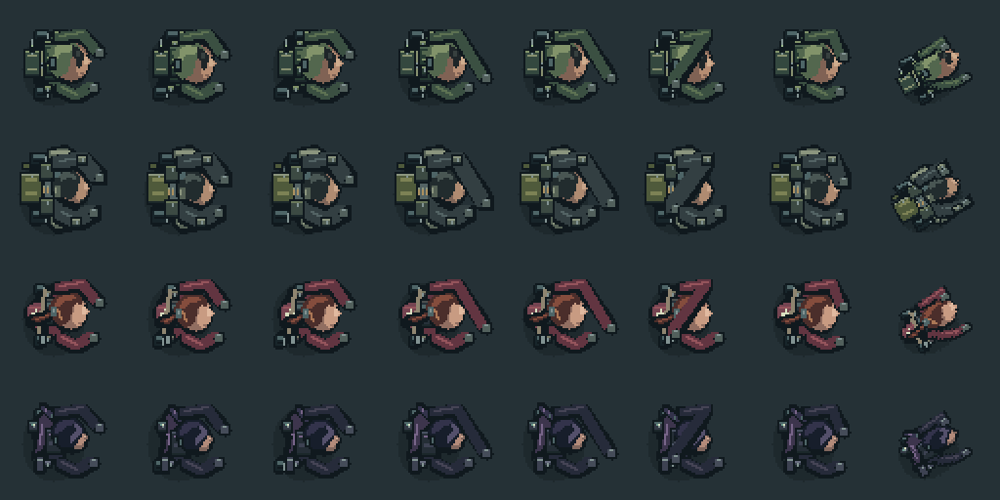
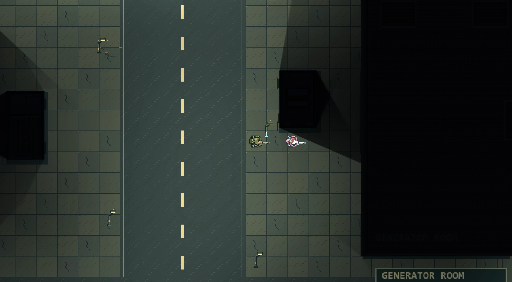
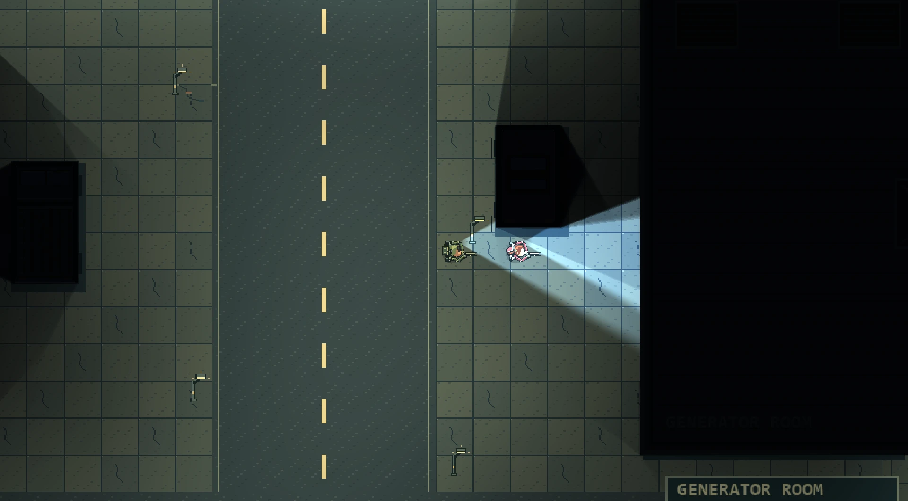

İlk demo yayımlandığından beri kampanyanın geri kalanının üzerine kurulacağı sistemleri geliştiriyoruz. Bu yazıda neyin değiştiğini anlatıyoruz.

Önce önemli bir not: **bunların hiçbiri henüz yayımlanmış demoda yok.** itch.io’daki demo hâlâ 0.1.0 sürümü. Aşağıdaki her şey güncel geliştirme sürümümüzde ve oyun testleri hâlâ sürüyor; bu yüzden ayrıntılar değişebilir.

## Sıfırdan çizilen dört asker

Ekipte artık dört kişi var: **Assault**, **Support**, sıhhiyeci **Elena Voss** ve nişancı **Raven Cross**. Her biri Pixelorama’da elle, kendine özgü bir silüetle çizildi: saçları, teçhizatları, çantaları ve omuz zırhları farklı. Aynı sprite’ın yeniden boyanmış kopyaları değiller.

Her karakterin sekiz animasyonu var: bekleme, yürüme, koşma, nişan alma, ateş etme, şarjör değiştirme, yaralanma ve ölüm. En ağır teçhizatı Support taşıyor: canı daha yüksek (100 yerine 140), koşusu biraz daha yavaş. Dördü de ilk askerle aynı silah tutuş sistemini kullanıyor; böylece altı silahın hepsi ellerine doğru oturuyor.

## Karakterler arası geçiş ve yapay zekâ takım arkadaşları

Kullanılabilir herhangi bir ekip üyesinin kontrolünü **F1–F4** ile alabilir ya da **Tab** ile sırayla geçebilirsiniz. Her karakter kendi canını, konumunu, silahını ve mühimmatını koruyor.

Kontrol etmediğiniz üyeleri yapay zekâ yönetiyor. Hareket yönünüze göre değişen ve dar geçitlerde sıkılaşan bir düzende sizi takip ediyorlar. Zombilerle aynı navigasyon sistemini kullanıyor, hedeflerini tehdit düzeyine göre seçiyor ve ellerindeki silahla savaşıyorlar. Takım arkadaşları hasar alabiliyor ve savaş dışı kalabiliyor; yani onları göz ardı edemezsiniz.

## 1. Bölüm artık iki kişilik bir görev

Geliştirme sürümünde 1. Bölüm artık tek başına oynanmıyor: **Elena Voss**, yapay zekâ takım arkadaşı olarak Assault’a katılıyor. Artık onun da kendi feneri var ve çevresi karanlık olduğunda fenerini kendiliğinden açıyor.

Plan, hikâye ilerledikçe ekibi büyütmek: önce Assault ve Elena, ardından Support, sonra Raven Cross. Bu kadro 250 bölümlük uzun vadeli hikâye planının bir parçası ve hâlâ değişebilir.

## Askerî Kredi ve ikmal mağazası

Ekip artık ortak bir **Askerî Kredi (CR)** bakiyesi kullanıyor. 1. Bölüm’ü bitirmek bir defalık **500 CR** ödül kazandırıyor. Ödül kaydınıza bağlı olduğu için bölümü tekrar oynamak ya da Yeni Oyun başlatmak onu ikinci kez ödemiyor.

Bölümün ardından **Askerî İkmal Terminali**’ne uğruyorsunuz. Terminalde silahlar, mühimmat ve üç farklı boyutta sağlık kiti dahil 14 ürün var; her satın almanın hangi ekip üyesine teslim edileceğini siz seçiyorsunuz. Ödeme, teslimat ve kayıt tek adımda gerçekleşiyor; böylece satın alma sırasında yaşanan bir çökme kredinize ya da eşyalarınıza mal olmuyor.

Bu, silahların işleyişini de değiştiriyor. Silahlar artık haritada ücretsiz olarak durmuyor; onları satın alıyorsunuz. Ekibin silahları, mühimmatı, canı ve kredileri kampanyanızla birlikte kaydediliyor. Ekonomi sistemi öldürmeler ve görevler için de ödül verebiliyor, ancak bu ödüller şimdilik 1. Bölüm’de kapalı.

## Hikâyeyi diyaloglarla anlatmak

1. Bölüm artık Assault ile Elena arasındaki kısa konuşmalarla açılıp kapanıyor: başta dokuz, sonda yedi satır. Konuşmalar oyun dünyasının üzerinde, ekranın altındaki bir panelde görünüyor: portre, konuşan kişinin adı, ilerleme sayacı ve İleri ile Atla düğmeleri. Atla, onay istiyor. Metnin harf harf değil de tek seferde görünmesini tercih ederseniz daktilo efektini Ayarlar’dan kapatabilirsiniz.

Pixelorama’da çizgi roman tarzında hikâye panelleri de çizdik. Henüz istediğimiz kalitede olmadıkları için oyunda yer almıyorlar.

Ana menüde artık **Devam Et** ve **Yeni Oyun** var. Yeni Oyun onay istiyor ve yalnızca 1. Bölüm ilerlemenizi sıfırlıyor. Hepsi bir araya geldiğinde bölüm artık baştan sona akıyor:

> dil seçimi → ana menü → açılış diyaloğu → görev → tamamlama ödülü → ikmal mağazası → kapanış diyaloğu → “2. Bölüm: Yakında”

## Yirmi dil

Oyun artık ilk açılışta bir dil seçmenizi istiyor; bu seçimi daha sonra Ayarlar’dan değiştirebilirsiniz. Arayüz ve 1. Bölüm diyalogları yirmi dilde mevcut: İngilizce, Türkçe, Japonca, Basitleştirilmiş ve Geleneksel Çince, Korece, Almanca, Fransızca, Latin Amerika ve İspanya İspanyolcası, Brezilya Portekizcesi, İtalyanca, Rusça, Lehçe, Arapça, Felemenkçe, Endonezce, Tayca, Vietnamca ve Ukraynaca.

Nasıl hazırlandıkları konusunda açık olalım: İngilizce dışındaki çeviriler, çevrim dışı çalışan makine çevirisi araçlarıyla üretildi. Henüz anadili bu diller olan kişiler tarafından incelenmedi. Kendi dilinizde yanlış okunan bir şey görürseniz lütfen bize bildirin.

## Kaybolan fener vakası

Testler sırasında fenerler bazen tamamen kayboluyordu ve bu en çok Elena, Assault’un hemen yanındayken oluyordu. Sorunun nedeni fenerin kendisi değil, bir çizim sınırı çıktı.

Kullandığımız renderer, tek bir sprite’ı en fazla **15 ışıkla** aydınlatabiliyor. Kampın zemini 1024 piksellik 16 büyük parçadan oluşuyordu. Jeneratör çalıştıktan sonra tek bir parçaya 22’ye kadar ışık düşebiliyordu. Elena’nın namlu alevleri, mermi çarpmaları ve feneri eklendiğinde bu sayı 26’ya çıkıyordu. Bir parçaya sınırdan fazla ışık düştüğünde renderer fazla ışıkları o parçanın tamamında atlıyor; fenerler de atlanan ışıklar arasındaydı.

Çözüm görselleri hiç değiştirmiyor: bölüm yüklenirken zemin artık 128 piksellik parçalara bölünüyor, böylece her parçaya çok daha az ışık düşüyor. Aşağıda elektrik açıkken aynı noktanın düzeltme öncesi ve sonrası görünüyor.

## Sırada ne var?

Şu anda bunların hepsini 1. Bölüm içinde test ediyoruz: ikili oynanışı, yapay zekâ takım arkadaşını, mağazayı, diyalogları ve dilleri. Ardından çalışmalar 2. Bölüm’e geçecek.

itch.io’daki demo hâlâ 0.1.0 sürümü. Yeni bir sürüm hazır olduğunda burada duyuracağız. O zamana kadar mevcut demoyu oynayabilirsiniz; geri bildirimlerinizi her zaman itch.io yorumlarından ya da zerquna.studios@gmail.com adresinden bekliyoruz.

Mevcut demoyu itch.io’dan oynayın: [zerqunastudios.itch.io/velkrion-the-first-breach](https://zerqunastudios.itch.io/velkrion-the-first-breach)
